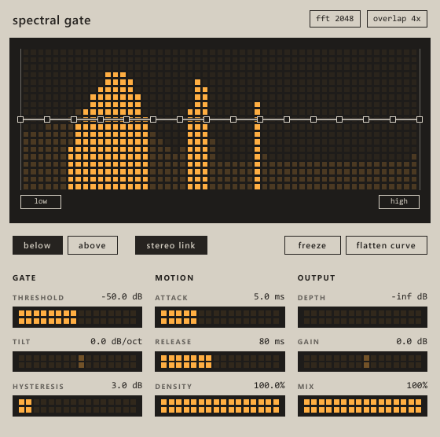

# spectral gate

per bin spectral gate vst3 written in rust with nih-plug and slint



drag on the display to move the threshold, drag the squares to shape the curve, density below 10% turns sustained stuff into particles

## build

```
cargo xtask bundle spectral_gate --release
```

the plugin ends up in `target/bundled/Spectral Gate.vst3`

for a quick look without a daw

```
SG_DEMO=1 cargo run --release --features standalone -- -b dummy
```
